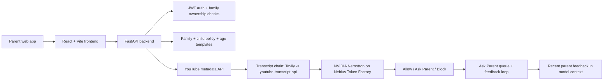

# KidsCrown

AI-powered family video review for YouTube. Parents define plain-language rules, and the app classifies each video as allow, ask parent, or block using YouTube metadata, transcript evidence, and recent parent feedback.

## What this project does

KidsCrown helps a parent set a family policy and one or more child-specific policies, then evaluate a YouTube URL against those rules. The backend pulls video metadata from the YouTube Data API, tries a transcript source chain, and uses NVIDIA Nemotron through Nebius Token Factory to make a structured classification.

The app is designed around a human-in-the-loop model:

- 🟢 Allow — clearly safe under the policy
- 🟡 Ask Parent — borderline or not confident enough to decide alone
- 🔴 Block — clearly against the policy

## Current repo status

This repository is already a working implementation rather than a blank scaffold. The backend is functionally complete and covered by automated tests; the frontend is built as a React + Vite app with the main onboarding, child flows, and profile screens in place.

Verified locally:

- `py -3 -m pytest tests -q` → 91 passed, 1 warning
- `py -3 -m pytest evals -q` → 59 passed, 1 skipped, 0 xfailed
- `py -3 -m pytest evals/test_deterministic.py -q` → 24 passed

The one skipped eval is the optional live injection test. The eval dataset has 29 cases: 24 concrete video IDs (24 live-capable rows) and 5 `FILL_ME_IN` placeholders, across clean, gaming, prank, adversarial, family_rules, policy_swap, no_transcript, and injection buckets.

## Stack

- Backend: FastAPI + SQLAlchemy + SQLite by default
- Frontend: React + Vite
- Auth: email/password + JWT bearer tokens
- AI: NVIDIA Nemotron via Nebius Token Factory
- Video data: YouTube Data API
- Transcript providers: Tavily extract first, then youtube-transcript-api fallback
- Cache: in-database cache keys for metadata, transcripts, and classification results

Classification cache keys include the profile ID, video ID, effective-policy hash, channel-rule state, and a SHA-256 digest of the profile-scoped feedback context passed to the model. The context preserves the existing newest-ten limit and ordering.

## Architecture



## Key implementation details

### Backend

The core app lives in `app/` and includes:

- `app/main.py` — API routes for auth, family/profile management, channel rules, classification, and queue resolution
- `app/models.py` — `Parent`, `Family`, `Profile`, `Classification`, `Feedback`, and `ChannelRule` models
- `app/service.py` — deterministic-first classification pipeline, transcript handling, and cache logic
- `app/nebius.py` — Nemotron request shape and JSON validation
- `app/transcript.py` — transcript provider chain and documented ambiguity handling
- `app/auth.py` — password hashing and JWT validation
- `app/policy.py` and `app/policy_templates.py` — family/child policy combination and age-band templates
- `app/video_context.py` — on-demand title/channel context for queue results

### Frontend

The React app lives under `frontend/` and includes:

- login/register flows
- onboarding + family creation
- add child/profile management
- age-template-driven policies
- child-specific rules and channel allow/block lists
- video check result cards
- Ask Parent queues and resolve actions
- app shell, top bar, and route-based UX

## Quick start

### 1) Python environment

Use Windows PowerShell or any shell that supports the venv commands you prefer:

```powershell
cd "c:\Users\ramne\IdeaProjects\kidscrown\kidscrown"
py -3 -m venv .venv
.\.venv\Scripts\Activate.ps1
pip install -r requirements.txt
```

### 2) Environment variables

Create a `.env` file in the repo root with the required values. The app reads these automatically:

```env
NEBIUS_API_KEY=your_nebius_key
YOUTUBE_API_KEY=your_youtube_data_key
TAVILY_API_KEY=your_tavily_key
JWT_SECRET=replace_with_a_32_plus_character_secret
CORS_ORIGINS=http://localhost:5173
```

Optional settings:

```env
JWT_EXPIRE_MINUTES=1440
NEBIUS_BASE_URL=https://api.tokenfactory.nebius.com/v1/
NEBIUS_MODEL=nvidia/NVIDIA-Nemotron-3-Nano-30B-A3B
BLOCK_AGE_RESTRICTED=true
DEFAULT_NEVER_WORDS_ENABLED=true
TRUSTED_CHANNELS_ENABLED=false
DISABLED_RULE_LAYERS=
REQUEST_BODY_MAX_BYTES=65536
CLASSIFY_IDENTIFY_REQUESTS_PER_FAMILY_PER_HOUR=30
```

`DISABLED_RULE_LAYERS` accepts a comma-separated subset of `channel_rule`,
`parent_answer`, `youtube_age_restricted`, `word_rule`, `format_rule`, and
`trusted_channel`. `BLOCK_AGE_RESTRICTED` and
`DEFAULT_NEVER_WORDS_ENABLED` default to true; trusted channels default off.
Trusted channel IDs are intentionally not prefilled. Add only reviewed IDs to
`app/data/trusted_channels.json`. To print YouTube search candidates from a
UTF-8 text file containing one `@handle` or channel name per line, run:

```powershell
py -3 scripts/resolve_trusted_channels.py candidate-channels.txt
```

The resolver only prints candidate channel IDs and titles; it never edits the
trusted-channel JSON.

### 3) Start the backend

```powershell
uvicorn app.main:app --reload --host 0.0.0.0 --port 8000
```

The API is available at `http://localhost:8000`.

### 4) Start the frontend

```powershell
cd frontend
npm install
npm run dev
```

The browser app runs on `http://localhost:5173` by default.

## Demo family / seeded data

A demo account is included for quick local walkthroughs:

- Email: `demo@kidscrown.local`
- Password: `DemoPass123!`

To create or refresh it:

```powershell
.\.venv\Scripts\python scripts\seed_demo_family.py
```

This script creates a demo family, a sample child, and a seeded Ask Parent item.

## Important behavior and limitations

### Transcript handling

The project intentionally uses a transcript chain rather than assuming transcript access is always available:

1. Tavily extract is tried first.
2. `youtube-transcript-api` is used as a fallback.
3. Only the final provider in the chain is allowed to treat a transcript as genuinely missing.
4. If no transcript is available, the app still classifies using title/description/channel and applies a safety-net rule: an `allow` becomes `ask_parent` with confidence capped at 0.69, while a `block` stays `block`.

This was included to deal with the real-world issue that Tavily’s `None` result can be ambiguous rather than a confirmed absence.

### Channel rules

Channel rules are deterministic and checked before the model path. If a channel is on a profile’s allow or block list, the app returns that decision immediately without a model call for the decision itself.

Channel rules belong to individual child profiles. Adding, changing, or removing a rule does not reuse a normal classification cached under a different rule state.

### Deterministic rules and settings

Before transcript lookup or Nemotron, KidsCrown checks the parent's answer for
the exact video and profile, YouTube's age-restricted signal, built-in and
family blocked words, the profile's format settings, and then the opt-in
trusted-channel list. Deterministic results are persisted with their
`decided_by` source and are not reused as model cache entries. `madeForKids`
is sent to Nemotron as a hint only; it cannot override the parent policy.

Family settings use `PUT /family` with an optional `blocked_words` string list
(up to 50 entries, each 2-40 characters). Profile settings use `POST /profiles`
or `PUT /profiles/{profile_id}` with an optional `format_rules` object:

```json
{
  "shorts": "model",
  "live": "model",
  "long_video_action": "model",
  "long_video_minutes": 60
}
```

Each action is `model`, `ask_parent`, or `block`. `model` preserves the existing
classification flow. Shorts are recognized only when the submitted URL path
contains `/shorts/`; the YouTube Data API metadata does not otherwise identify
Shorts reliably.

`GET /profiles/{profile_id}/channel-rule-suggestions?min_answers=3` returns
unanimous, profile-scoped channel suggestions as
`[{"channel_id":"UC...","channel_name":"...","action":"allow","answers":3}]`.
Only distinct answered videos count, mixed decisions are excluded, and
channels with an existing rule are omitted. Apply a suggestion using the
existing `POST /profiles/{profile_id}/channel-rules` request:
`{"channel_id":"UC...","channel_name":"...","action":"allow"}`.

### Input and request limits

Policy and request limits are defined in `app/config.py`: family policy text is
limited to 2,000 characters, child policy text to 2,000, channel-rule notes to
200, and blocked words to 100 entries of at most 50 characters each. The
combined effective family + child policy may not exceed 4,500 characters and
receives a clear HTTP 422 response if it does. All request bodies are limited
to 64 KiB by default (HTTP 413 above the limit). `/classify` and `/identify`
share a default limit of 30 requests per family per hour (HTTP 429 above the
limit). `REQUEST_BODY_MAX_BYTES` and
`CLASSIFY_IDENTIFY_REQUESTS_PER_FAMILY_PER_HOUR` adjust the latter limits.
The rate counter is in-memory per server process; deployments with multiple
workers should use a shared rate-limit store for a global family quota.

The family and child policy editors show a live character count and stop input
at 2,000 characters. Server validation errors, including combined-policy 422s,
are shown in the form.

### Data and privacy

The app stores parent accounts, family policy text, and child records in its database. The project is a demo/package for a parent-facing child safety workflow, not a production-grade public dataset or user consent system.

## Testing

Backend and offline eval tests are included in the repo. Current verified results are:

```powershell
py -3 -m pytest tests -q
py -3 -m pytest evals -q
py -3 -m pytest evals/test_deterministic.py -q
```

Results: backend 106 passed with 1 warning; frontend 57 passed; frontend production build succeeds. Eval suite 59 passed, 1 skipped, 0 xfailed; deterministic eval module 24 passed. The skipped eval is the optional live injection test.

`py -3 evals/run_evals.py --dry-run` previews the selected cases and estimated calls without contacting a model. The runner does not currently execute live evaluations: `--live` reports that live execution is unimplemented and exits with status 3. `--compare` currently prints the prior report timestamp only; it does not calculate metric differences.

## Project structure

```text
app/                 FastAPI backend
  auth.py            auth and JWT helpers
  config.py          env-backed settings
  db.py              database session and schema bootstrap
  main.py            API routes and auth checks
  models.py          SQLAlchemy models
  nebius.py          Nebius/Nemotron client and prompt logic
  policy.py          effective-policy hashing and combination
  policy_templates.py age-band policy templates
  service.py         classification flow and cache orchestration
  transcript.py      transcript provider chain
  youtube.py         YouTube metadata client
frontend/            React + Vite app
scripts/             demo seeding and local utilities
tests/               backend test suite
requirements.txt     Python dependencies
```

## Near-term gaps to close

The repo is already functional, but the remaining work is mostly product polish and deployment readiness:

- finish the combined Ask Parent queue experience across the main view
- polish the seeded demo family and preloaded example videos
- tighten the deployed app workflow and environment documentation
- finalize the production deployment story, including secrets, CORS, and host setup
- continue the kid-mode / enforcement roadmap as a post-demo feature, not a required part of the current app

## Why this project matters

KidsCrown is a policy agent with a human decision loop: parents express their rules in everyday language, and the app decides whether a video is safe, uncertain, or clearly inappropriate. It is not a browser extension or a device-level enforcement layer; it is a decision layer the parent can use to review content before or alongside a child’s watch session.
